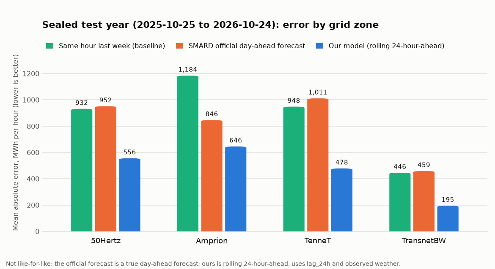
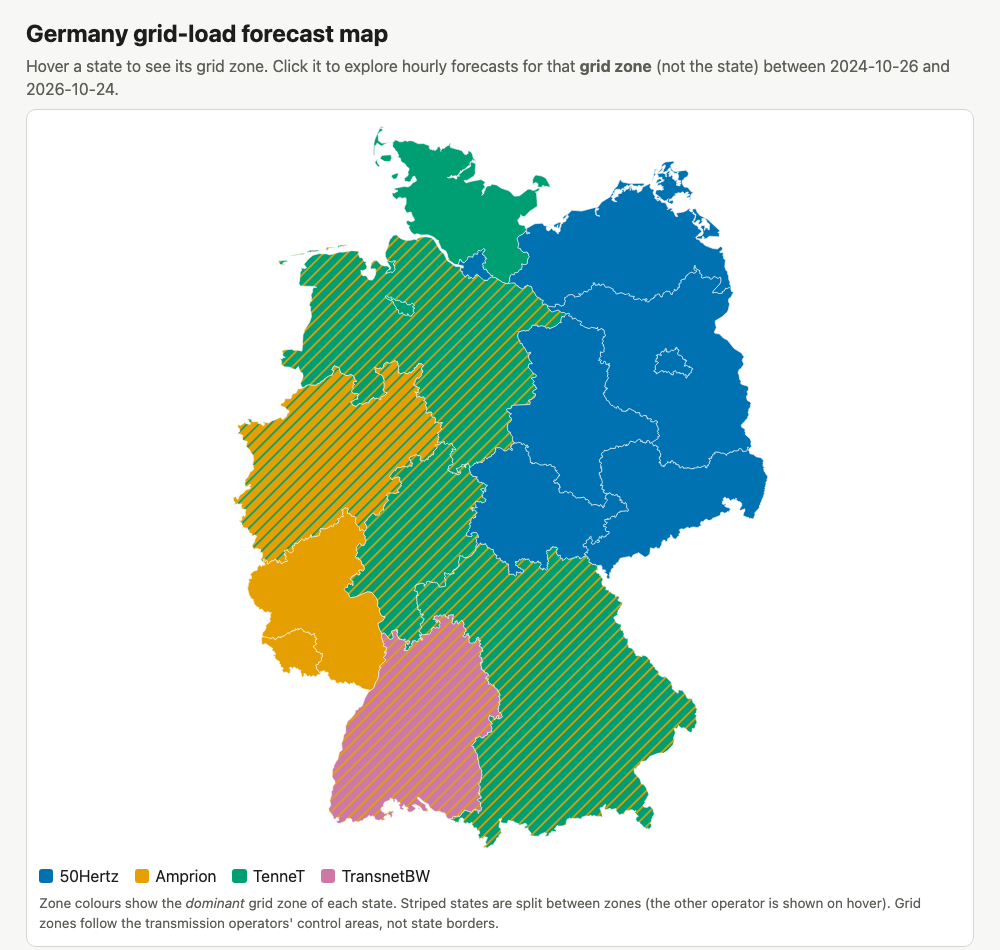
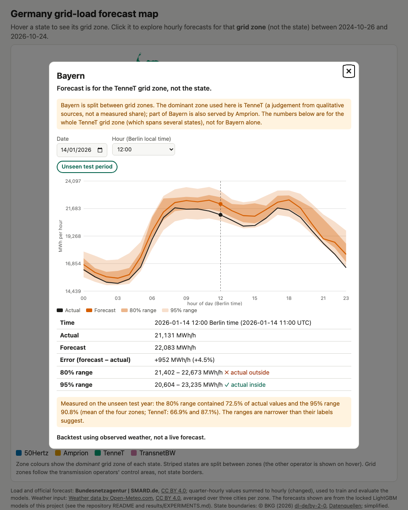
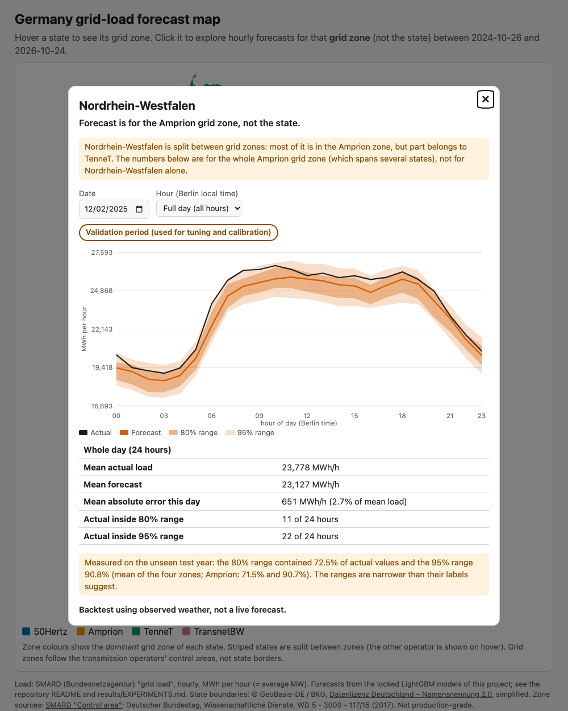
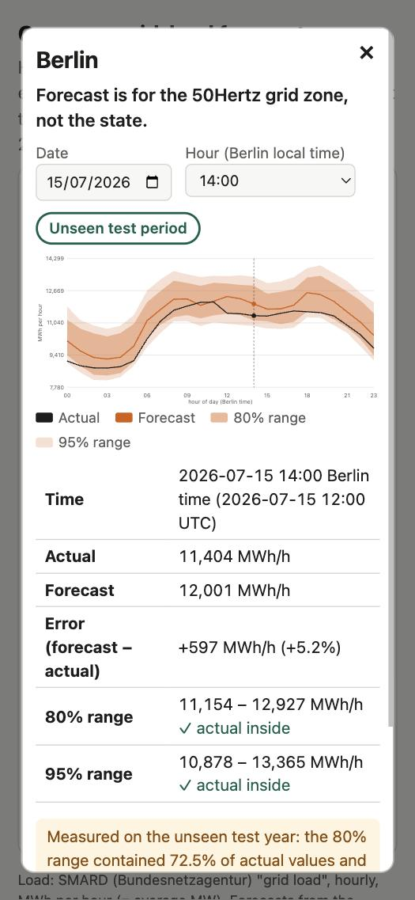

# Germany electricity demand forecasting (4 grid zones)

## In plain English
This project predicts how much electricity Germany's four grid zones (50Hertz, Amprion, TenneT, TransnetBW) draw from the grid, hour by hour, and shows the forecasts on an [interactive map](site/). It is a portfolio baseline, not a production system.

<picture>
  <source media="(prefers-color-scheme: dark)" srcset="docs/results_chart_dark.png">
  
</picture>

- **Accuracy.** On a final year of data that was held back during development (2025-10-25 to 2026-10-24), the model's average hourly error is 40% to 56% lower than simply copying last week's load, and 24% to 58% lower than the official day-ahead forecast that the grid operators publish on SMARD (numbers in the chart and in the table under *Results*).
- **That comparison favours this model.** The official forecast is a true day-ahead forecast, issued the day before. This model is a *rolling 24-hour-ahead* forecast: for every hour it already knows the load from 24 hours earlier, and it uses observed instead of forecast weather. In a validation-year experiment, taking away the 24-hour-old load made the model roughly **9% to 18% worse** (+8.7% without `lag_24h`, +18.1% without `lag_24h` and `lag_48h`); this is a validation estimate and was not re-run on the final year. So the model's accuracy is *not* day-ahead accuracy.
- **The uncertainty ranges are too narrow.** Ranges labelled 80% and 95% contained only **72.5%** and **90.8%** of the real final-year values on average over the zones. Treat the ranges as optimistic.
- **It got worse on new data.** The error on the final year was 5% to 35% higher than on the validation year the model was tuned on.
- **Other limits** (see *Limitations*): missing recent load history hurts a lot, holidays are harder, the map assigns each state to one zone by judgement, and the licence terms of the data sources are summarised in [`data/DATA_SOURCES.md`](data/DATA_SOURCES.md).


A portfolio baseline that forecasts **hourly grid load** for Germany's four TSO control areas (50Hertz, Amprion, TenneT, TransnetBW), with prediction intervals, stress tests and one sealed final test. It is not production-grade; see *Limitations*. **Status: data, models, uncertainty, stress tests, final evaluation and the interactive map are done.**

## Problem
Predict hourly load per zone, treating every load-based input as known at least 24 h before the target hour (lags of 24 h and more). This is a **rolling 24-hour-ahead** forecast, issued separately for every hour; it is *not* a day-ahead forecast issued once per day, because at a single daily issue time `lag_24h` would be unavailable for the later hours of the next day (see the lag ablation under *Limitations*). One important shortcut: the weather inputs are **observed/reanalysis values at the target hour**, not weather forecasts (see *Stress tests* for what weather error does).

## Data and licences
Details, series IDs, URLs and the reasoning for the series choice: [`data/DATA_SOURCES.md`](data/DATA_SOURCES.md). Raw data is not committed.
- **Load**: SMARD (Bundesnetzagentur) "Grid load", filter 410, quarter-hourly per control area (values are MWh per 15 min; the hourly value is the sum of the four). Downloaded 2026-11-08. Series 410 reproduces the three SMARD website reference values exactly (60,003 / 59,180 / 56,841 MWh at 2022-06-01 16:00-18:00 UTC; the brief had labelled them in the owner's UTC+8 time). The sum of the four zones matches SMARD's national total (median difference 0.000% on train+validation, 99% of hours within 2.4%).
- **Weather**: Open-Meteo historical archive (no key), hourly, three cities per zone averaged: temperature, humidity, wind speed, shortwave radiation, cloud cover.
- **Holidays**: Python `holidays` package per German state; the zone feature is the equal-weight share of the zone's states that have a holiday that Berlin-local day. The state-to-zone mapping in `src/gepf/data.py` is an approximation (TSO areas do not follow state borders).
- **Licences**: I recorded SMARD and Open-Meteo as CC BY 4.0 from memory and have **not verified** the current terms; check them before publishing. **State shapes** for the map: BKG VG250 state boundaries (official WFS), licence *Datenlizenz Deutschland – Namensnennung 2.0* (dl-de/by-2-0, stated in the service's own capabilities document), attribution "© GeoBasis-DE / BKG"; simplified for the web (`scripts/build_site_geo.py`).
- Data checks (all automated in `tests/test_data_sanity.py`): no duplicate hours, regular hourly UTC index, no gaps inside train+validation (the 72-75 missing hours per zone in the raw range are almost all the empty days before 2015-01-01, plus a few unpublished newest hours), 23/25-hour daylight-saving days, plausible magnitudes (2019: 56.8 GW mean, 497 TWh), weekday > Sunday, winter > summer.

## Method
- **Split by time only**, dataset ends 14 days before the last available hour: train < 2024-10-25, validation 2024-10-25..2025-10-24, **test 2025-10-25..2026-10-24** (8,760 h each for validation and test). The test period lives in a separate file (`data/processed/sealed_test.parquet`). It was **evaluated once**, by `scripts/final_eval.py --confirm-final`. The file was read again afterwards in two places, with no metric computed and no model, offset or result changed: by `scripts/export_site_data.py` (to write the map's hourly forecasts) and by a one-off snippet that counted missing inputs per zone (not saved as a script in the repo; its code is quoted in `results/EXPERIMENTS.md`, entry R1). So the accurate statement is: one evaluation, three reads of the file.
- **Features** (`src/gepf/data.py`, `src/gepf/models.py`): Berlin hour, weekday, month, day of year, weekend, bridge day (Monday/Friday next to a Tuesday/Thursday holiday), zone holiday share, five weather variables, and load lags 24/48/168/336 h. Leakage tests are in `tests/test_leakage.py`.
- **Model**: LightGBM 4.7.0, one regressor per zone (600 trees, learning rate 0.05, 31 leaves, seed 42). A pooled model with zone as a feature was 4% worse on validation. scikit-learn's HistGradientBoosting was not used because LightGBM imported.
- **Baselines**: B0 same hour yesterday, B1 same hour last week (B1 is the better one).
- **Intervals**: LightGBM quantile models (2.5/10/50/90/97.5%) trained on train only, plus conformalized quantile regression (CQR) with one offset per zone and band calibrated on the validation year. Calibration per hour of day (24 groups, or 6-hour blocks) was tried and rejected.
- Every experiment, rule (written before results), decision and commit: [`results/EXPERIMENTS.md`](results/EXPERIMENTS.md).

## Results
**Final sealed test (2025-10-25..2026-10-24), MAE in MWh/h, run once (rolling 24-hour-ahead with observed weather; see Limitations):**

| Zone | B1 last week | SMARD official day-ahead forecast | Model | Model vs B1 | Model vs official | Model MAPE | Validation MAE (model) |
|---|---|---|---|---|---|---|---|
| 50Hertz | 932 | 952 | 556 | -40% | -42% | 4.8% | 531 |
| Amprion | 1184 | 846 | 646 | -45% | -24% | 3.5% | 524 |
| TenneT | 948 | 1011 | 478 | -50% | -53% | 3.1% | 355 |
| TransnetBW | 446 | 459 | 195 | -56% | -58% | 3.0% | 164 |

The model beat B1 in every zone, and also on public holidays, the hottest 5% and the coldest 5% of test days (model/B1 error ratio 0.20-0.29, 0.42-0.65 and 0.32-0.40). It was nevertheless worse on test than on validation (+5% to +35% MAE; part of that is a harder year, since B1 also got worse in Amprion and TenneT; I did not investigate further). B0 (yesterday) is worse than B1 wherever it is available; for 50Hertz it came out as NaN in the final run (missing lag_24h hours) and was not re-run. Full tables: `results/final_test_*.csv`.

## Benchmark: SMARD's official day-ahead forecast
SMARD publishes a "Forecasted consumption" series for each of the four control areas (filter 411, quarter-hourly, from 2015; also for Germany as a whole), submitted by the TSOs the day before. I downloaded it (`scripts/download_official_forecast.py`) and scored it on the same sealed test hours as our model (`scripts/compare_official_forecast.py`, `results/official_forecast_comparison.csv`; the comparison rule was committed before the series was downloaded, see `results/EXPERIMENTS.md`, entry O1). This is reporting only: our model, its lock and its logged numbers are unchanged, and no new model metric was computed.

**Our model has the lower MAE in all four zones (24% to 58% lower), but this comparison favours us and is not like-for-like.** The official forecast is a true day-ahead forecast issued the day before (SMARD says the TSOs submit it the day before, based on day-ahead trading results, and that it may be updated afterwards if it changes by more than 10%; the downloaded series is the latest published one). Our model is a rolling 24-hour-ahead forecast that uses `lag_24h` and `lag_48h` and observed instead of forecast weather. To size the lag part of that difference, the validation-only ablation (see *Limitations*) shows +8.7% mean validation MAE without `lag_24h` and +18.1% without `lag_24h` and `lag_48h`; I did not compute any adjusted test number, and the advantage from using observed weather is not measured. The gap to the official forecast is larger than the lag effect, but the two are not comparable one-to-one.

Other things to know about the official numbers: the per-zone official forecasts are no better than copying last week in three zones (MAE 952 vs 932 for 50Hertz, 1011 vs 948 for TenneT, 459 vs 446 for TransnetBW) and clearly better only in Amprion (846 vs 1184). As a sanity check of the series (a post-hoc check, labelled as such in the log), the national official forecast has MAPE 3.8% on the test year, a plausible size for a TSO forecast. TransnetBW's official forecast runs about 6% above actual load on both validation and test (a systematic offset I did not investigate); removing it would lower its MAE from 459 to 341, still well above our 195. The official series is missing 24 of TenneT's 8,760 test hours (0.27%), which are left out of the official TenneT score only.

## Prediction intervals
Nominal vs observed coverage, mean over the four zones:

| Band | Raw quantiles (test) | With CQR (validation, calibrated on the other half) | With CQR (test) |
|---|---|---|---|
| 80% | 58.0% | 80.0% | **72.5%** |
| 95% | 78.4% | 94.2% | **90.8%** |

So the intervals are **too narrow on new data**: calibration on one period does not transfer (only 50Hertz is near nominal on test: 78.9% / 94.4%). Coverage is worst around midday (80% band 64-67% at 12-16 h on test) and over-covered at night. Plots: `results/figures/coverage.png`, example week `results/figures/fan_example.png`.

## Stress tests (all inside train+validation; `scripts/stress_tests.py`, details in EXPERIMENTS.md)
- **Rolling-origin backtest** (8 expanding-window folds: calendar years 2018-2023, 2024-01-01 to 2024-10-24, and the validation year): the model beats B1 in every window and zone.
- **Holidays etc.**: lower error than B1 on every subset, but higher than its own average on Christmas-New Year (1.3-1.7x), public holidays (1.2-1.5x) and bridge days (1.2-1.8x). Heat waves are easier than average, cold snaps about average.
- **Shift**: trained before 2020, evaluated 2020-22 without retraining: within 0-10% of the retrained model and far better than B1.
- **Weather error** (noise levels are my assumptions, not measured forecast errors): +2-9% MAE at level 1, +15-32% at level 4 for three zones; TransnetBW is much more sensitive (+25% at level 1, +60% at level 4).
- **Missing data** (no imputation): 30% missing weather hours cost about +12% (TransnetBW +31%). **Missing load history is the real weak spot**: 10% missing lags cost about +35-41%, 30% about +125-136% (averages over the four zones; per zone the 10% case ranges from +19% for 50Hertz to +53% for Amprion), and the model becomes worse than B1 in some zones.

## Interactive map (`site/`)
Plain HTML/JS/SVG, no libraries, no map tiles, no API keys. Serve and open:
```bash
python3 -m http.server -d site 8000   # then open http://localhost:8000  (file:// does not work: the page loads JSON)
```
Hover a state: its name and grid zone. Click: a popup with a date picker (2024-10-26 to 2026-10-24, Berlin local days), an hour picker or full-day chart, and actual, forecast, 80% and 95% ranges and the error for the chosen hour. The popup always states "Forecast is for the [zone] grid zone, not the state", shows a badge per date ("Unseen test period", or "Validation period (used for tuning and calibration)", or a mixed-day note for 2025-10-25), the measured test coverage of the ranges next to them (72.5% and 90.8% on average over the zones, plus the zone's own value; read from `results/final_test_coverage.csv`), and "Backtest using observed weather, not a live forecast". Deep links work, e.g. `http://localhost:8000/#state=BY&date=2026-01-14&hour=12`.

Screenshots:    

- **Data**: `scripts/export_site_data.py` runs the *locked* models (SHA-256 verified, refuses unless the final evaluation was already run) to write `site/data/{zone}.json` for validation and test hours. It computes no metrics; the test period was not re-evaluated, retuned or recalibrated for the map, and the headline numbers above are unchanged. Forecast = the mean model; ranges = quantile models plus the validation-calibrated conformal offsets (the same ones evaluated on the test period). The forecast lies inside the 95% range in 99.9% of hours.
- **Which hours have missing inputs (test year 2025-10-25..2026-10-24, counted by that one-off snippet from the sealed file; the 6 excluded hours are also visible as `hours_left_out` in `site/data/meta.json`)**: Amprion, TenneT and TransnetBW: none. 50Hertz: 6 of 8,760 hours (2 with a missing actual load value, and the 2 hours exactly one week and the 2 exactly two weeks later whose lag_168h / lag_336h partner is missing). **Handling**: these 6 hours are excluded from the final evaluation (that is why 50Hertz has n = 8,754 there) and are left out of the map, which shows them as missing; four of the remaining 50Hertz hours have a missing lag_24h or lag_48h, which LightGBM handles natively (no imputation). No weather input is missing in any zone. Validation has no missing hours.
- **Zone assignment**: each state is assigned its *dominant* grid zone (`src/gepf/zones.py`, the same mapping used for the holiday feature). Sources, all qualitative: SMARD, [Control area](https://www.smard.de/page/en/wiki-article/5884/205642) (50Hertz north and east, Amprion west and south-west, TransnetBW a large part of Baden-Württemberg, TenneT from Denmark to the Alps); Deutscher Bundestag, Wissenschaftliche Dienste, [WD 5 - 3000 - 117/16 (2017)](https://www.bundestag.de/resource/blob/494452/29f6a6424b8d97b6aad95ff22cfa6577/WD-5-117-16-pdf.pdf), section 2, which lists the states per operator and quotes the ewi study, which names more than one operator for Niedersachsen, Nordrhein-Westfalen, Hessen, Baden-Württemberg and Bayern. Those five states are flagged "split" (striped on the map and with a warning in the popup). **No source gives area or load shares**, so "dominant" is my judgement from the wording (e.g. TenneT for Hessen and Bayern, Amprion for Nordrhein-Westfalen) and could be wrong for Hessen in particular; I did not find the TSOs' own maps in a machine-readable form, and the sources are from 2012-2017.

## Limitations
- Rolling 24-hour-ahead, not day-ahead. Every load input is known at least 24 h earlier, but a forecast issued once per day could not use `lag_24h` for the later hours of the next day. A validation-only ablation (`scripts/run_lag_ablation.py`, `results/lag_ablation_val.csv`; locked models unchanged) shows the dependence: without `lag_24h` the mean validation MAE rises by 8.7% (50Hertz +3.2%, Amprion +10.9%, TenneT +10.6%, TransnetBW +15.8%); without `lag_24h` and `lag_48h` it rises by 18.1% (+7.1%, +21.3%, +22.6%, +33.3%). Both variants still pass the keep rule and are far better than the last-week baseline, but by the threshold I set beforehand (15%) the headline MAEs depend materially on the short lags and **must not be read as day-ahead numbers**.
- Weather inputs are observed values, so the headline numbers are optimistic for a real forecasting setting (a rolling 24-hour-ahead forecast would use forecast weather, whose errors would add to them; see weather-noise results).
- Grid load is the SMARD "Grid load" series, not total electricity consumption; zones are TSO control areas, not states; the holiday-to-zone mapping is approximate.
- Prediction intervals do not hold their nominal coverage on the test year (above).
- Patterns shift over time (the test year was harder than validation); the model is retrained only once, on data before 2024-10-25.
- Holiday/bridge-day/heat statistics rest on few days; the stress-test noise levels are assumptions.
- The model has not been compared with the TSOs' own forecasts, and nothing here shows that it beats them.
- Hessen / Frankfurt mismatch: Hessen is assigned to TenneT (map and holiday share, `src/gepf/zones.py`, `src/gepf/data.py`), but one of Amprion's three weather points is Frankfurt, which lies in Hessen. So for Amprion the weather input includes a Hessen city while the holiday input does not include Hessen, and TenneT's holiday input includes Hessen while its weather points (Munich, Hannover, Nuremberg) do not. The holiday share also weights every state of a zone equally (Bayern counts as much as Bremen). Both are approximations, and I did not test their effect.
- Map: a state is not a forecast target. The forecast is for the TSO grid zone, which does not follow state borders; five states are split between zones, and the dominant-zone choice rests on qualitative sources. The map is a backtest with observed weather and cannot show future dates.
- Licence terms of the load and weather sources are not verified (see above); the BKG state-shape licence is the one stated by the service itself. Not production-grade.

## How to run
```bash
python3 -m venv .venv && source .venv/bin/activate
pip install -r requirements-dev.txt        # exact versions (Python 3.14.5), incl. shapely for the map shapes; on macOS LightGBM needs libomp: brew install libomp
python scripts/download_load.py            # slow: roughly 25-40 min per zone
python scripts/download_reference.py       # SMARD national series, used only for checks
python scripts/download_weather.py
python scripts/build_dataset.py            # writes data/processed/{trainval,sealed_test}.parquet
python scripts/data_card.py                # sanity numbers and plots (train+validation only)
python scripts/baselines.py
python scripts/run_models.py M1 M2 M3 M4
python scripts/run_quantiles.py && python scripts/run_quantiles_hourly.py
python scripts/run_lag_ablation.py         # validation-only lag ablation
python scripts/download_official_forecast.py   # SMARD official day-ahead forecast (benchmark only)
python scripts/stress_tests.py
python scripts/train_final.py --force      # rebuilds models/ (gitignored) and OVERWRITES results/model_lock.json, see below
python scripts/download_states.py && python scripts/build_site_geo.py   # state shapes
python scripts/export_site_data.py         # map data from the locked models
python scripts/compare_official_forecast.py     # benchmark table; needs site/data and the downloaded official forecast
python scripts/check_official_forecast_sanity.py  # post-hoc sanity check of the official series
python scripts/make_summary_chart.py       # the chart at the top of this README
PYTHONPATH=src pytest                      # last, so that no test is skipped; see the notes below
python3 -m http.server -d site 8000        # serve the map (keeps running; open http://localhost:8000)
```
**Tests and what they need.** Run `PYTHONPATH=src pytest`. The data-sanity tests skip when `data/raw/` is absent, the site-data tests skip when `site/data/` is absent, and the model-dependent gate tests skip with the message "models/ is absent or empty" until `models/` exists (it is gitignored, so a fresh checkout has no models). Run `train_final.py` *before* `pytest` if you want all of them to run. On a fresh checkout without data or models some tests are therefore skipped, not passed.

**`train_final.py` and the committed lock.** `results/model_lock.json` is committed and its hashes are quoted in `results/EXPERIMENTS.md` (entry F1). The script now refuses to run when that file exists unless you pass `--force`, because re-training may produce different hashes and would overwrite the lock. To check whether your rebuild reproduces the committed hashes, run it with `--force`, then `git diff results/model_lock.json` (no diff means identical hashes); restore the committed lock with `git checkout results/model_lock.json` if they differ.

**`final_eval.py` is one-shot.** `python scripts/final_eval.py --confirm-final` evaluated the sealed test period exactly once (2026-11-08) and cannot be run again: it exits with code 3 because `results/FINAL_EVAL_DONE` exists (exit 2 without `--confirm-final`, exit 4 if a model file does not match the lock). The results are stored in `results/final_test_metrics.csv`, `final_test_subsets.csv`, `final_test_coverage.csv`, `final_test_coverage_by_hour.csv` and `final_test_meta.json`, and are committed. The "once" is enforced only by the marker file (a convention: deleting it would allow a second run, which would break the protocol). `--dummy --out-dir <dir>` runs the pipeline on synthetic data without touching the sealed file or `results/`.
