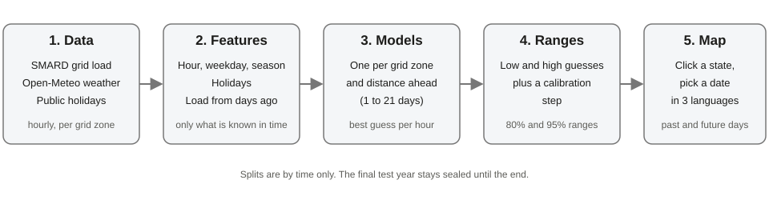
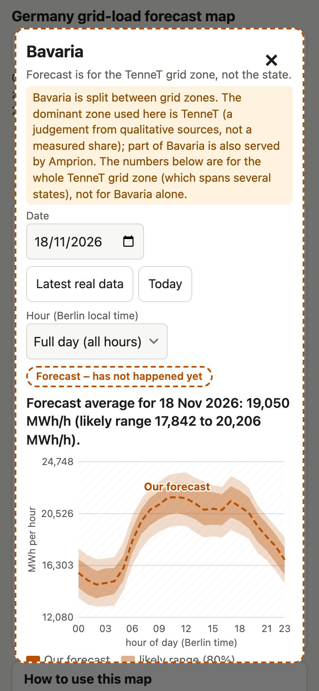
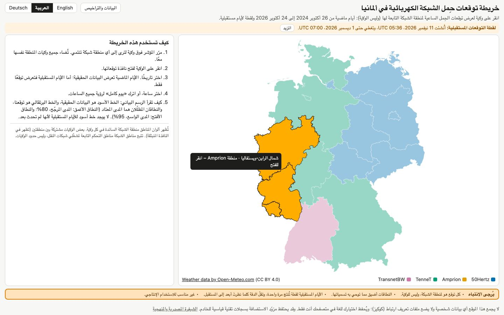
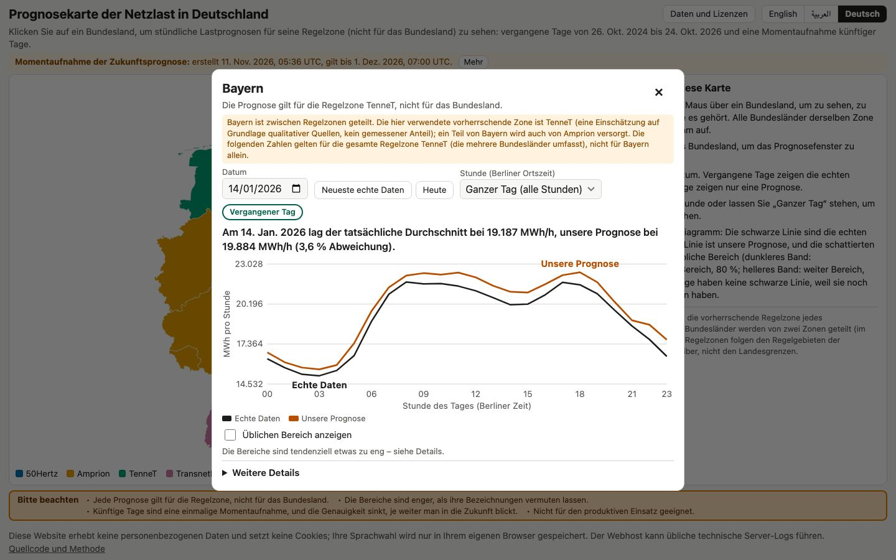

# Germany electricity demand forecasting

This project forecasts how much electricity Germany's four grid zones use, hour by hour. We use grid-load data from SMARD (the German energy market data site), weather data from Open-Meteo and public holidays. Our models predict past days, which we compare with what really happened, and future days up to 21 days ahead. We use it for four things: an interactive map, an honest picture of how reliable a forecast is, a worked example of how to test a forecast fairly, and as a portfolio project. It is not a production system.

We built this with AI assistance (Claude Code) and reviewed the results ourselves.

Available in English, Deutsch and العربية. The translations are AI-assisted and not professionally reviewed; corrections are welcome (open an issue or edit `site/i18n/*.json`).

Live map: [link to be added]

Docs: [docs/METHODS.md](docs/METHODS.md) · [docs/DETAILED_RESULTS.md](docs/DETAILED_RESULTS.md) · [docs/HOW_TO_RUN.md](docs/HOW_TO_RUN.md) · [results/EXPERIMENTS.md](results/EXPERIMENTS.md)

## Data and licences
We took only data that is published for reuse, and we credit every source. Raw data is not committed to this repository. Series IDs, URLs, quotes from the terms pages (read on 2026-11-09) and open questions are in [`data/DATA_SOURCES.md`](data/DATA_SOURCES.md). This is our reading of the public terms, not legal advice.

| What we used | Who publishes it | Licence | What we changed |
|---|---|---|---|
| Grid load per zone, and the official day-ahead forecast (for comparison) | **Bundesnetzagentur \| SMARD.de** | CC BY 4.0 | Summed the four quarter-hours of each hour into hourly values |
| Weather (temperature, humidity, wind, solar radiation, cloud) | **Weather data by [Open-Meteo.com](https://open-meteo.com/)** | CC BY 4.0. The free API is for **non-commercial use only**. Whether a public portfolio counts as non-commercial is a grey area. | Averaged over three cities per zone |
| State boundaries | © BKG (2026), dl-de/by-2-0, [Datenquellen](https://sg.geodatenzentrum.de/web_public/gdz/datenquellen/datenquellen_vg_nuts.pdf) | dl-de/by-2-0 | Simplified |
| Public holidays | Python `holidays` package (version 0.108) | MIT (checked in the installed package) | Used per German state; the zone value is the share of its states on a holiday |
| Our code | us | MIT, see [`LICENSE`](LICENSE) | |

Good to know: we fetched SMARD data from the undocumented endpoints behind its charts, and SMARD says it is reviewing its data-use concept. The MIT licence does not change the data terms: files here that contain or come from these data (`site/data/`, the results tables) keep the credits and terms of their sources. This is a non-commercial portfolio project with no advertising or subscriptions. Anyone who re-runs the download scripts for a commercial purpose must check the terms first (Open-Meteo requires a paid plan for commercial use).

## What we built

1. **Data.** Hourly grid load for each zone, weather averaged over three cities per zone, and public holidays per state.
2. **Features.** What the model is allowed to look at: hour, weekday, month, holidays, the load from earlier days, and sometimes a weather forecast. A model never sees anything that would not yet be known at the time of the forecast.
3. **Models.** One LightGBM model (a tree-based method that learns from past examples) for each grid zone and each distance ahead: 1, 2, 3, 5, 7, 10, 14, 16 and 21 days. A separate 24-hour model is our main model for past days.
4. **Ranges.** Next to each best guess we show an 80% and a 95% range, from models that predict a low and a high guess, plus a calibration step that tries to make the ranges honest.
5. **Map.** A static web page: click a state, pick a date, see our forecast next to what really happened, or a forecast only for days that have not happened yet.

## How we tested it fairly
- **Split by time, never at random.** Hours from the future are never used to learn about the past.
- **A sealed test year.** The last year sits in a separate file. We looked at it only through a one-shot script, after all choices were locked.
- **Simple baselines.** We compare against "the same hour last week" (we call it B1) and "the same hour yesterday". Beating a clever model proves little if you have not beaten the simple one.
- **Rules before results.** For every experiment we wrote down what would count as a win before we saw the numbers, and logged it in [`results/EXPERIMENTS.md`](results/EXPERIMENTS.md).

| Period | Dates | Hours | Used for |
|---|---|---|---|
| Training | everything before 2024-10-25 | from 2015 onward | learning |
| Validation | 2024-10-25 to 2025-10-24 | 8,760 | choosing settings and calibrating ranges |
| Test (sealed) | 2025-10-25 to 2026-10-24 | 8,760 | the final check |

The sealed year is not as untouched as we would like: we used it for two different model families (see *Problems and mistakes*).

## Results
<picture>
  <source media="(prefers-color-scheme: dark)" srcset="docs/results_chart_dark.png">
  
</picture>

*Each group of bars is one grid zone. Shorter is better: the bar is the typical size of our miss on the sealed test year.*

**Typical miss on the sealed test year (2025-10-25 to 2026-10-24).** The measure is MAE, the typical size of our miss, in megawatt-hours per hour (MWh/h). Lower is better.

| Zone | Last week's load (simple baseline) | SMARD official day-ahead forecast | Our model, 24 h rolling | Our model, 7 days ahead | Our model, 21 days ahead |
|---|---|---|---|---|---|
| 50Hertz | 932 | 952 | 556 | 692 | 710 |
| Amprion | 1,184 | 846 | 646 | 940 | 1,126 |
| TenneT | 948 | 1,011 | 478 | 706 | 781 |
| TransnetBW | 446 | 459 | 195 | 301 | 391 |

The first column is the simple baseline, copying last week's load. The third is the official forecast from SMARD, the German energy market data site. The fourth is our 24-hour model. The last two are our multi-day models, 7 and 21 days ahead. The numbers come straight from `results/*.csv` (`python scripts/readme_results_table.py`) and are checked by `tests/test_readme_numbers.py`.

**In plain words.** Our 24-hour model misses by 40% to 56% less than copying last week's load, and in every zone it beat the simple baseline, also on public holidays and on the hottest and coldest 5% of days. It was worse on the test year than on the validation year it was tuned on (+5% to +35% in MAE). Part of that is a harder year, because the simple baseline also got worse in Amprion and TenneT. We did not investigate further.

**What "24-hour rolling" means.** For every hour the model already knows the load from 24 hours earlier, and it uses observed instead of forecast weather. A forecast issued once a day could not do that. See *The problem we set out to solve* below.

**Comparison with SMARD's official forecast.** Our 24-hour model has the lower MAE in all four zones (24% to 58% lower), but this comparison favours us and is not like-for-like. The official forecast is a true day-ahead forecast, issued the day before. Our model is a rolling 24-hour-ahead forecast. In a validation-year experiment, taking away the 24-hour-old load made our model 8.7% worse (+8.7% without `lag_24h`) and taking away the two most recent days made it 18.1% worse (+18.1% without `lag_24h` and `lag_48h`). We did not compute an adjusted test number. So the win says little about real day-ahead skill, and it does not show that we beat the grid operators.

**Future days (multi-day models, sealed test year).** Typical miss in MWh/h, with the best simple baseline at the same distance in brackets:

| Zone | 1 day ahead | 7 days ahead | 21 days ahead |
|---|---|---|---|
| 50Hertz | 664 (932) | 692 (932) | 710 (1,053) |
| Amprion | 690 (1,184) | 940 (1,184) | 1,126 (1,593) |
| TenneT | 531 (948) | 706 (948) | 781 (1,218) |
| TransnetBW | 229 (446) | 301 (446) | 391 (592) |

Our multi-day models beat the best simple baseline in all 36 zone-and-distance cells, by 21% to 49%. That is a low bar, because those baselines copy a week that is already old. The full tables, the caveats and the method are in [docs/DETAILED_RESULTS.md](docs/DETAILED_RESULTS.md).

## How sure are we?
Next to every best guess we show ranges. An 80% range should contain the real value about 80 times out of 100. Coverage means how often it really does.

**They are too narrow.** On the sealed test year our ranges labelled 80% and 95% contained only **72.5%** and **90.8%** of the real values (mean of the four zones). In TenneT it was 66.9% and 87.1%. Treat our ranges as optimistic. The method we used (conformal calibration) is only guaranteed to work if the future behaves like the past, and electricity demand does not.

*Left: on the validation year, the raw ranges (blue and green dots) are far too narrow, and after calibration (orange and red squares) they sit near the dashed target lines. That check is on the validation year, so it looks better than the test year did. Middle: coverage by hour of day; the ranges miss most around midday. Right: raw coverage by month.*

*One validation week for Amprion. The black line is the real load, the blue line our forecast, and the shaded bands are the 80% (darker) and 95% (lighter) ranges. This week was part of the data used for calibration, so the bands look better than they would on new data.*

**What we tried.** For future days we tested calibrating on only the most recent weeks of errors, and a method that adapts as it goes. We tested them on the validation year only, with rules written first:

| Method | Mean coverage 80% / 95% | Worst cell 80% / 95% | Mean width (MWh/h) | Mean interval score | Score vs static | Admissible |
|---|---|---|---|---|---|---|
| static | 83.3% / 95.7% | 72.8% / 90.4% | 2,447 | 2,934 | 1.000 | yes |
| rolling_8w | 80.0% / 94.7% | 78.1% / 93.4% | 2,168 | 2,794 | 0.970 | yes |
| aci_g0.005 | 79.9% / 94.9% | 75.2% / 93.6% | 2,805 | 3,475 | 1.208 | no |

The rolling 8-week method (`rolling_8w`) kept coverage close to the targets without making the ranges much wider, so we use it for **future days only**. The adaptive method had the smallest gap but made the ranges so wide that our rule excluded it. Caveats: this was checked on the same validation year it was chosen on; the "static" row over-covers here, the opposite of what happened on the test year; and when we applied it, only the 16 days after the sealed year were usable for calibration, a shorter window than the 8 weeks we tested. **Past days on the map keep the old ranges**, so past and future ranges are not comparable. Every interval row is in [docs/DETAILED_RESULTS.md](docs/DETAILED_RESULTS.md). The real test is the prospective check below.

## Stress tests
We pushed the model with changes to the inputs. All of these used only training and validation data (`scripts/stress_tests.py`, details in [`results/EXPERIMENTS.md`](results/EXPERIMENTS.md)).
- **Different time windows.** We tested 8 expanding time windows (calendar years 2018 to 2023, 2024-01-01 to 2024-10-24, and the validation year). The model beat last week's load in every window and zone.
- **Holidays and weather extremes.** The model beat last week's load on every subset. But its own error is higher than average on Christmas to New Year (1.3 to 1.7 times), public holidays (1.2 to 1.5 times) and bridge days (1.2 to 1.8 times). Heat waves are easier than average, and cold snaps about average.
- **A shift in time.** Trained before 2020 and tested on 2020 to 2022 without retraining, the model was within 0% to 10% of the retrained model and far better than last week's load.
- **Weather errors.** The noise levels are our assumptions, not measured forecast errors. At the lowest level the error grows by 2% to 9% (three zones), at the highest by 15% to 32%. TransnetBW is much more sensitive (+25% and +60%).
- **Missing data (no filling in).** Losing 30% of the weather hours costs about 12% (TransnetBW 31%). **Missing load history is the real weak spot.** Losing 10% of the past load values costs about 35% to 41%, and losing 30% costs about 125% to 136% (averages over the four zones; for the 10% case it ranges from +19% in 50Hertz to +53% in Amprion). In some zones the model then becomes worse than last week's load.

## Other models we tried
We compared our LightGBM models with a ridge regression (a simple straight-line model) and a small neural network, on the validation year only and at 1, 7 and 21 days ahead. Ridge was clearly worse in all 12 cases. The small neural network was about as good as LightGBM (pooled MAE 6,380 against 6,365; ridge 7,919), and it beat LightGBM by more than 1% in 6 of 12 cases, so LightGBM is not clearly better. We kept LightGBM because the models were already locked and its settings were picked on this same validation year. Full table: [docs/DETAILED_RESULTS.md](docs/DETAILED_RESULTS.md). The test year was not used.

## The interactive map
Plain HTML, JavaScript and SVG: no libraries, no map tiles, no accounts and no tracking.

- Hover over a state to see its name and grid zone; all states of the same zone light up together. Click to open a centred window.
- Pick a date from 2024-10-26 to 2026-12-01 (Berlin local days) and an hour, or keep "Full day".
- Past days show the real load (black line), our forecast (orange line) and the error. Future days show our forecast only, with ranges.
- "Show usual range" switches the shaded ranges on and off. "Latest real data" and "Today" jump to those dates. "More details" opens tables, accuracy and all the caveats.
- Every popup says the forecast is for the grid zone, not the state, and shows the measured test coverage of the ranges (72.5% and 90.8% on average, plus the zone's own value). Past days carry a badge ("Unseen test period" or "Validation period (used for tuning and calibration)") and the note "Backtest using observed weather, not a live forecast". Five states are split between zones and carry a warning.
- English, Deutsch and العربية, with right-to-left layout for Arabic. It works on phones.
- **Privacy.** The map has no cookies, no tracking, and makes no requests to other sites. Your language choice is stored only in your own browser. Whoever hosts the page may keep standard server logs.

*The overview. Hovering over a state (here Bavaria) highlights all states of its grid zone and shows a label. The panel on the right explains how to use the map, and the orange note at the bottom lists the main cautions.*

*A past day (14 January 2026). The black line is the real load, the orange line is our forecast, and the one-sentence headline says how far off we were. The buttons "Latest real data" and "Today" sit next to the date.*

*A future day (29 November 2026). There is no black line because the day has not happened. The dashed border and the label "Low-confidence outlook" mark days 17 to 21, which use no weather. The "Show usual range" switch is on, and the shaded bands are the 80% and 95% ranges.*

*"More details" holds the whole-day averages, a table of how accurate this distance is, the warning that the ranges are too narrow, and the note on which range method future days use.*

*On a phone the popup fills the width and scrolls inside. A single tap on a state opens it.*

*Arabic, laid out right to left. The instructions panel moves to the left, and numbers stay in Latin digits.*

*The same popup in German (Deutsch). Dates, numbers and all text follow the chosen language.*

## Prospective check (pending)
The one real test of the future forecast is to compare it with what happens.

- **What we predicted.** The snapshot generated on 2026-11-11 05:36 UTC (forecast origin 2026-11-10 07:00 UTC) covers 2026-11-11 06:00 to 2026-12-01 07:00 UTC for all four zones. We saved it before the hours happened in `results/prospective/forecast_20261110T07_20261111T053623Z.json`, **SHA-256 `897be3dc27dda1d05a09cc2db677593c5bf52488166fd40360c663325f49cafe`**, first committed in `35791f5ee8372a29edf7cfdef3316c0c37b9a1f6`. The same forecast with the newer ranges is in `results/prospective/intervals_rolling_8w_20261110T07_20261111T053623Z.json` (the point forecasts are identical), so both range methods can be scored on the same hours.
- **When we will check.** On or after about 2026-12-05, when SMARD has published the load for the whole period (see [docs/HOW_TO_RUN.md](docs/HOW_TO_RUN.md)). We will report the result **whatever the outcome**, including if the model loses to last week's load or the new ranges miss as badly as the old ones. We have only tested the script on fake data (`tests/test_prospective.py`).

<!-- PROSPECTIVE:START -->
*Pending: no results yet.*
<!-- PROSPECTIVE:END -->

## Problems and mistakes we ran into
- **The test year was used twice.** We used the sealed year once for the 24-hour model and, later, once for the multi-day models; the file was also read for the map and for a missing-data count, with no metrics. Nothing was tuned on it, and we say so everywhere, but it is no longer untouched.
- **The ranges were too narrow.** On the test year they covered 72.5% and 90.8% instead of 80% and 95%. We could not fix this for past days without touching the test year.
- **The fix is only tested on validation data.** The rolling recalibration was chosen and judged on the same validation year, and could only be calibrated on 16 days. The prospective check will tell.
- **Missing hours for 50Hertz.** The test year has 6 hours of 8,760 that we had to leave out: 2 had no load value, and the 2 hours exactly one week and the 2 exactly two weeks later lost a model input. They are excluded from the evaluation and shown as missing on the map.
- **Comparing with SMARD is not like-for-like.** The official forecast is a true day-ahead forecast and our 24-hour model is a rolling one that sees the load of 24 hours earlier and observed weather. We added the lag experiment to size the difference.
- **Open-Meteo rate limits, and a script that ran by accident.** Downloading the archived forecasts hit the per-minute and per-hour limits (HTTP 429), so the script waited and retried until it worked. Separately, importing one of our own scripts briefly started a download of the weather data (about 4 requests) before we stopped it. It wrote nothing (the weather file was unchanged), and the script now has a guard.
- **A mismatch for Hessen.** We assign Hessen to TenneT for holidays and the map, but one of Amprion's three weather points is Frankfurt, which lies in Hessen. So Amprion's weather includes a Hessen city while its holiday input does not. We did not test the effect.
- **The models are not refitted.** They were trained on data before 2024-10-25, so they are about two years old.

## The problem we set out to solve
Predict hourly load per zone, treating every load-based input as known at least 24 hours before the target hour (lags of 24 hours and more). This is a **rolling 24-hour-ahead** forecast, issued separately for every hour. It is *not* a day-ahead forecast issued once per day, because at a single daily issue time `lag_24h` (the load 24 hours earlier) would be unavailable for the later hours of the next day (see the lag experiment in [docs/DETAILED_RESULTS.md](docs/DETAILED_RESULTS.md)). One important shortcut: the weather inputs are **observed values at the target hour**, not weather forecasts (see *Stress tests* for what weather error does).

## Limitations
- **Rolling 24-hour-ahead, not day-ahead.** Every load input is known at least 24 hours earlier, but a forecast issued once per day could not use the load of 24 hours earlier for the later hours of the next day. In a validation-only experiment (`scripts/run_lag_ablation.py`, `results/lag_ablation_val.csv`) the average validation MAE rose by 8.7% without `lag_24h` and by 18.1% without `lag_24h` and `lag_48h`. Both variants still beat the last-week baseline, but by the threshold we set beforehand (15%) the headline numbers depend materially on the short lags and **must not be read as day-ahead numbers**.
- **Observed weather.** The headline numbers use observed weather, so they are optimistic. A real rolling forecast would use forecast weather, and its errors would add to ours.
- **The comparison with the official forecast is not like-for-like.** We compared our model with SMARD's official day-ahead forecast, but not on equal terms (see above). It does not show that we beat the grid operators.
- **Ranges.** Our ranges do not reach their nominal coverage on the test year (72.5% and 90.8%). Ranges for future days use a newer method that has been checked on validation data only and calibrated on 16 days; past days keep the older method, so the two are not comparable.
- **The data is not total consumption.** It is the SMARD "Grid load" series. Zones are the grid operators' control areas, not states, and the holiday-to-zone mapping is approximate. Holidays are shared equally among the states of a zone (Bavaria counts as much as Bremen); we did not test the effect.
- **Things change over time.** The test year was harder than the validation year. The models were trained once, on data before 2024-10-25, and are about two years old.
- **Few examples for special days.** Statistics for holidays, bridge days and heat waves rest on few days, and our stress-test noise levels are assumptions.
- **Hessen and Frankfurt.** See *Problems and mistakes*: the weather points and the holiday input for Amprion and TenneT do not match the zone assignment.
- **Future days.** Archived weather forecasts reach only 7 days of lead time, so models for days 8 to 21 use no weather at all, and for days 1 to 7 forecast weather was used in only 6 of 36 zone-and-distance models (it helped by 2% to 6% there). Days 17 to 21 are a low-confidence outlook. Accuracy falls the further ahead you look: for TenneT the typical miss is 531 MWh/h at one day and 781 at 21 days. Live weather forecasts may differ from the archived ones we trained on. The future days are a one-off snapshot, and the page does not update itself.
- **The test year was used twice**, as described above.
- **The map.** A state is not a forecast target. The forecast is for the grid zone, which does not follow state borders. Five states are split between zones, and our choice of the dominant zone rests on qualitative sources (no source gives load shares). Past dates on the map are a backtest with observed weather.
- **Missing hours.** 50Hertz has 6 hours left out of the test year (see above).
- **Translations.** German and Arabic are AI-assisted and have not been reviewed by native speakers. We tested the page in Chromium and WebKit, not in Firefox.
- **Data terms.** Read on 2026-11-09, not legal advice. The Open-Meteo free API is non-commercial only, and SMARD's data-use concept is under review (see [`data/DATA_SOURCES.md`](data/DATA_SOURCES.md)).
- **Not production-grade.**

