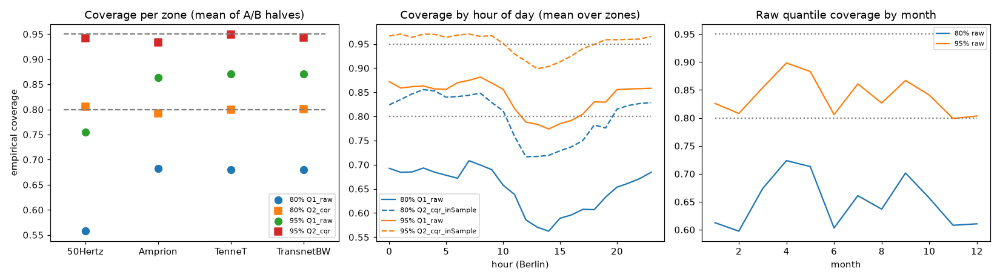
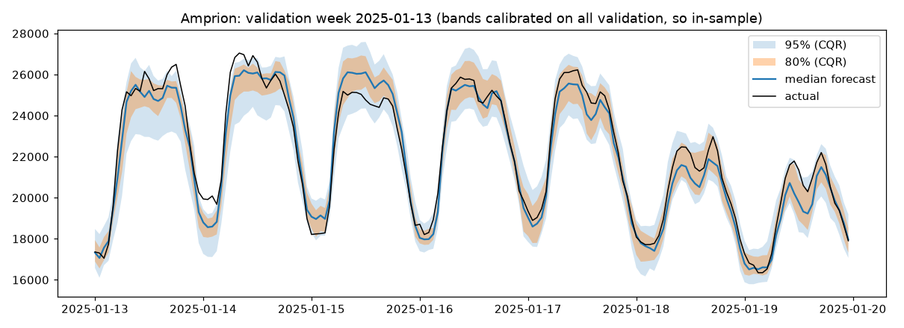
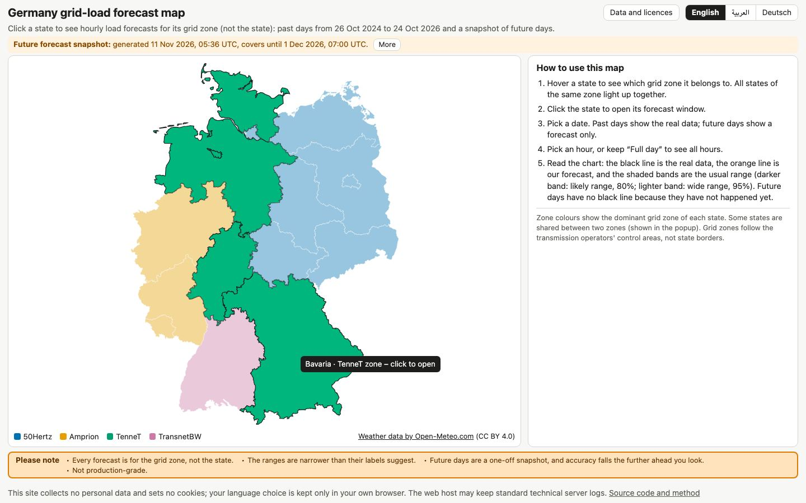
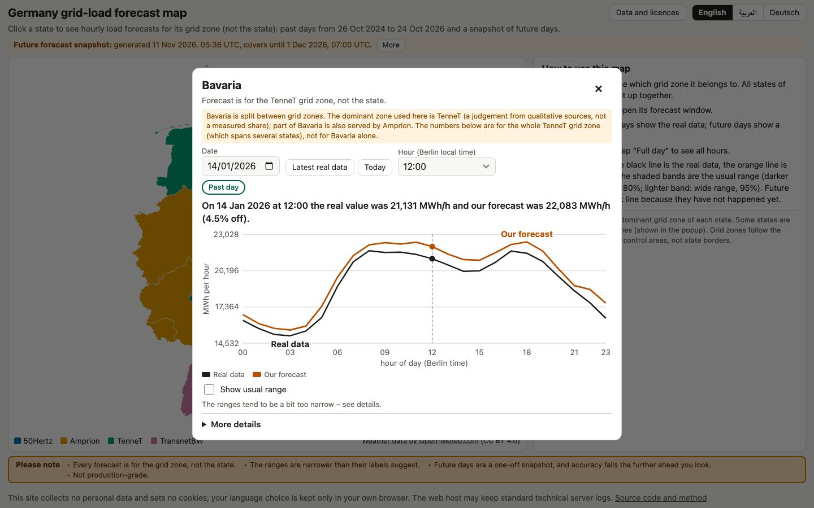
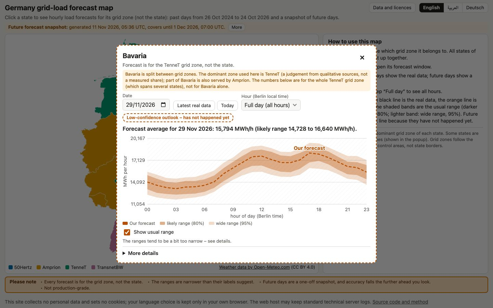
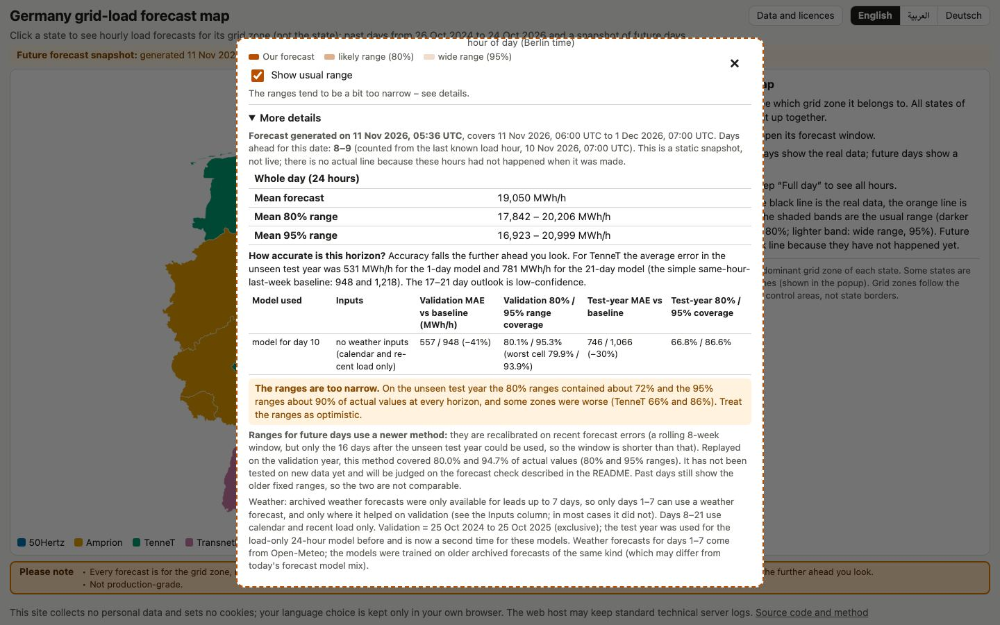

# Germany electricity demand forecasting

This project forecasts how much electricity Germany's four grid zones use, hour by hour. We use grid-load data from SMARD (the German energy market data site), weather data from Open-Meteo and public holidays. Our models forecast hourly electricity use for past days and for future days up to 21 days ahead. This project is for testing and learning purposes. It is not a production system.

Status: published on 12 November 2026. Everything in this README describes the project as it was on that date. The map covers dates up to 1 December 2026.

Available in English, Deutsch and العربية. The translations are AI-assisted and not fully reviewed yet.

Live map: [link to be added]

Docs: [docs/METHODS.md](docs/METHODS.md) · [docs/DETAILED_RESULTS.md](docs/DETAILED_RESULTS.md) · [docs/HOW_TO_RUN.md](docs/HOW_TO_RUN.md) · [results/EXPERIMENTS.md](results/EXPERIMENTS.md)

## Data and licences
We took only data that is published for reuse, and we credit every source. Raw data is not committed to this repository. Series IDs, URLs, quotes from the terms pages (read on 2026-11-09) and open questions are in [`data/DATA_SOURCES.md`](data/DATA_SOURCES.md). This is our reading of the public terms, not legal advice.

| What we used | Who publishes it | Licence | What we changed |
|---|---|---|---|
| Grid load per zone, and the official day-ahead forecast (for comparison) | **Bundesnetzagentur \| SMARD.de** | CC BY 4.0 | Summed the four quarter-hours of each hour into hourly values |
| Weather (temperature, humidity, wind, solar radiation, cloud) | **Weather data by [Open-Meteo.com](https://open-meteo.com/)** | CC BY 4.0. The free API is for **non-commercial use only**. Whether a public portfolio counts as non-commercial is a grey area. | Averaged over three cities per zone |
| State boundaries | © BKG (2026), dl-de/by-2-0, [Datenquellen](https://sg.geodatenzentrum.de/web_public/gdz/datenquellen/datenquellen_vg_nuts.pdf) | dl-de/by-2-0 | Simplified |
| Public holidays | Python `holidays` package (version 0.108) | MIT (checked in the installed package) | Used per German state; the zone value is the share of its states on a holiday |
| Our code | us | MIT, see [`LICENSE`](LICENSE) | |

## The problem we set out to solve
We want to forecast the electricity use of each grid zone, hour by hour. Every input about past use must be at least 24 hours old when we make the forecast. We make a new forecast for every hour, so we call it a rolling 24-hour forecast. It is not a day-ahead forecast made once a day: at one fixed time each day, we would not yet know the use from 24 hours before for the later hours of the next day. One shortcut: we use the weather that really happened at each hour, not a weather forecast; the stress tests show what wrong weather does.

## What we built
1. We collected the hourly electricity use of four grid zones, the weather, and the public holidays.
2. We trained a computer model for each zone and each forecast distance. It learns the usual patterns: time of day, weekday, season, holidays and recent use.
3. We tested the models on a full year they had never seen.
4. We added a "likely range" next to each forecast, to show how unsure we are.
5. We built a web map to explore the forecasts.

We built it with Python, LightGBM models (a method that learns from past examples) and a plain web page with no tracking.

## How the results were tested
- **Split by time.** We always predict later hours from earlier ones, never the other way round.
- **A test year we kept hidden.** The last year of data was set aside and used only for the final check.
- **Simple comparisons.** We compare with copying the same hour last week, because a clever model means little if it cannot beat a simple one.

| Period | Dates | Hours | Used for |
|---|---|---|---|
| Training | everything before 2024-10-25 | from 2015 onward | learning |
| Validation | 2024-10-25 to 2025-10-24 | 8,760 | choosing settings and calibrating ranges |
| Test (hidden until the end) | 2025-10-25 to 2026-10-24 | 8,760 | the final check |

## Results
<picture>
  <source media="(prefers-color-scheme: dark)" srcset="docs/results_chart_dark.png">
  
</picture>

*Each group of bars is one grid zone. In each group there are three bars: copying last week, the official SMARD forecast, and our 24-hour model. The shorter the bar, the closer the forecast was to what really happened.*

How far off the forecasts were, on average, in megawatt-hours per hour (MWh/h), on the test year (25 Oct 2025 to 24 Oct 2026). Smaller is better. For example, 556 means the forecast was about 556 MWh off in an average hour.

| Zone | Last week's load (simple baseline) | SMARD official day-ahead forecast | Our model, 24 h rolling | Our model, 7 days ahead | Our model, 21 days ahead |
|---|---|---|---|---|---|
| 50Hertz | 932 | 952 | 556 | 692 | 710 |
| Amprion | 1,184 | 846 | 646 | 940 | 1,126 |
| TenneT | 948 | 1,011 | 478 | 706 | 781 |
| TransnetBW | 446 | 459 | 195 | 301 | 391 |

- **Last week's load:** simply copy last week.
- **SMARD forecast:** the official forecast made the day before.
- **Our 24-hour model:** our main model.
- **7 and 21 days ahead:** our models for future days.

**In plain words.** Our 24-hour model's average miss was 40% to 56% smaller than copying last week's load, in every zone, including holidays and the hottest and coldest days. It did worse on the test year than on the year we tuned it on (5% to 35% more error), partly because that year was harder.

**What "24-hour rolling" means.** For every hour, the model already knows the electricity use from 24 hours before. It also uses the weather that really happened, not a weather forecast.

**Comparison with SMARD.** Our model had a smaller miss than SMARD's forecast in all four zones (24% to 58% smaller), but this is not a fair fight, because SMARD's forecast is made the day before while our model knows the use from 24 hours earlier and the real weather. When we took away the 24-hour-old use in a test, our error grew by 8.7%, and by 18.1% when we also took away the use from 48 hours before. So this does not show that we beat the grid operators.

**Future days.** How far off our models were on the test year, in MWh/h, with copying last week's load (the best simple comparison at the same distance) in brackets:

| Zone | 1 day ahead | 7 days ahead | 21 days ahead |
|---|---|---|---|
| 50Hertz | 664 (932) | 692 (932) | 710 (1,053) |
| Amprion | 690 (1,184) | 940 (1,184) | 1,126 (1,593) |
| TenneT | 531 (948) | 706 (948) | 781 (1,218) |
| TransnetBW | 229 (446) | 301 (446) | 391 (592) |

Our models for future days beat the simple comparison in all 36 zone-and-distance cases, by 21% to 49%. That is a low bar, because the simple comparison copies a week that is already old. The full tables are in [docs/DETAILED_RESULTS.md](docs/DETAILED_RESULTS.md).

## How sure are we?
Each forecast has a range. An 80% range should contain the real value about 80 times out of 100.

**Our ranges are too narrow.** On the test year, our 80% ranges held the real value 72.5% of the time and our 95% ranges 90.8% (TenneT: 66.9% and 87.1%). So treat our ranges as too hopeful. The ranges were set using one year, and electricity use patterns change over time.

*On the year we tuned on, the plain ranges were far too narrow and the adjusted ones sit near the targets (dashed lines); the test year was worse.*

*One week in January 2025 for Amprion: the black line is the real use, the blue line our forecast, and the bands our ranges. This week was part of the data we set the ranges on, so it looks better than new data would.*

**What we tried.** For future days we tested setting the ranges again from only the latest weeks of errors, and a method that adjusts itself as it goes. We tested them on the tuning year only, with the rules written down first:

| Method | Typical share of real values inside the 80% and 95% ranges | Average width of the 80% range, in MWh/h |
|---|---|---|
| Old method: one fixed setting (`static`) | 83.3% and 95.7% | 1,882 |
| New method: reset on the last 8 weeks (`rolling_8w`) | 80.0% and 94.7% | 1,682 |
| Self-adjusting method, left out because the ranges got too wide (`aci_g0.005`) | 79.9% and 94.9% | 2,208 |

Resetting the ranges on the last 8 weeks kept the share close to the targets without making the ranges much wider, so we use it for **future days only**. The self-adjusting method came closest to the targets but made the ranges so wide that our rule left it out. Be careful with this: we checked it on the same year we chose it on; the old method covered more than its target in this test, the opposite of what happened on the test year; and only the 16 days after the test year could be used to set the ranges, a shorter time than the 8 weeks we tested. **Past days on the map keep the old ranges**, so past and future ranges cannot be compared. Every row is in [docs/DETAILED_RESULTS.md](docs/DETAILED_RESULTS.md). The real test is the check described below.

## Stress tests
We pushed the model with changes to its inputs. All of these used only training and validation data.
- **Different time windows.** We tested 8 time windows (the calendar years 2018 to 2023, 2024-01-01 to 2024-10-24, and the tuning year). The model beat last week's load in every window and zone.
- **Holidays and weather extremes.** The model beat last week's load on every kind of day. But its own error is higher than usual around Christmas and New Year (1.3 to 1.7 times), on public holidays (1.2 to 1.5 times) and on bridge days (1.2 to 1.8 times). Heat waves are easier than usual, and cold spells about usual.
- **A shift in time.** We trained only on data before 2020 and tested on 2020 to 2022. The model stayed within 0% to 10% of a model that was retrained, and it was far better than last week's load.
- **Wrong weather.** We made up the amount of noise ourselves; it is not measured forecast error. At the lowest level the error grows by 2% to 9% (three zones), at the highest by 15% to 32%. TransnetBW is much more sensitive (+25% and +60%).
- **Missing data (we did not fill gaps).** Losing 30% of the weather hours costs about 12% (TransnetBW 31%). **Missing past electricity use is the real weak spot.** Losing 10% of it costs about 35% to 41% more error, and losing 30% costs about 125% to 136% (averages over the four zones; for 10% it ranges from +19% in 50Hertz to +53% in Amprion). In some zones the model then becomes worse than last week's load.

## Other models we tried
We compared our LightGBM models with a ridge regression (a simple straight-line model) and a small neural network, on the tuning year only, at 1, 7 and 21 days ahead. Ridge was clearly worse in all 12 cases. The small neural network was about as good as LightGBM (pooled average miss 6,380 against 6,365; ridge 7,919), and it beat LightGBM by more than 1% in 6 of 12 cases, so LightGBM is not clearly better. We kept LightGBM because the models were already locked and its settings were picked on this same year. The full table is in [docs/DETAILED_RESULTS.md](docs/DETAILED_RESULTS.md). The test year was not used.

## The interactive map
- Hover over a region to light up its grid zone, and click it to see the forecast for that zone.
- A date picker lets you choose any day from 2024-10-26 to 2026-12-01, and an hour or the full day.
- The colours: each map colour is one grid zone (50Hertz is blue, Amprion is orange, TenneT is green and TransnetBW is pink). A state gets the colour of its main zone, and every forecast is for the zone, not for the state; five states are shared between two zones and show a warning. In the chart, the black line is what really happened, the orange line is our forecast, and the shaded bands are the likely range (darker 80%, lighter 95%).
- The site is available in English, Deutsch and العربية.
- The site has no cookies, no tracking and makes no requests to other websites. (Your language choice is saved only in your own browser, and the host may keep standard server logs.)

*The start page. Hovering over a state lights up its whole grid zone, and a panel on the right explains how to use the map.*

*A past day. The black line is what really happened and the orange line is our forecast; the sentence above the chart says how far off we were.*

*A future day. There is no black line because the day has not happened yet. The label "Low-confidence outlook" marks days 17 to 21, which we trust least.*

*"More details" shows the numbers behind the chart and all our warnings.*

## Prospective check (pending)
We made forecasts on 11 Nov 2026 for the next three weeks and saved them before the hours happened.
Fingerprint of the saved file (SHA-256): `897be3dc27dda1d05a09cc2db677593c5bf52488166fd40360c663325f49cafe`, first committed in `35791f5ee8372a29edf7cfdef3316c0c37b9a1f6`.
We will add the result here in December 2026, whatever it is.

<!-- PROSPECTIVE:START -->
*Pending: no results yet.*
<!-- PROSPECTIVE:END -->

## Problems and mistakes we ran into
- **The test year was used twice.** That is a problem because the test year should be used only once to stay a fair check. It happened because a second set of models was added later, and no unused data was left.
- **The ranges were too narrow.** That is a problem because they promise more than they deliver. It happened because we set them on one year, and electricity use changed.
- **The fix for the ranges is only tested on one year of older data.** That is a problem because we do not know yet whether it works on new data. It happened because the test year was off limits, so only 16 days of newer data were available.
- **Comparing with SMARD is not a fair fight.** That is a problem because it makes our model look better than it would in the same job. It happened because our model sees the use from 24 hours earlier and the real weather.
- **The models are two years old.** That is a problem because patterns change. It happened because we trained them once, before October 2024, and locked them before testing.

## Limitations
- **Rolling forecast, real weather.** Our main model is a rolling 24-hour forecast, not a true day-ahead one, and it uses the weather that really happened. So its numbers are better than a real day-ahead forecast would be: without the 24-hour-old use our error grew by 8.7%, and by 18.1% without the 24-hour-old and 48-hour-old use.
- **Ranges.** Our ranges are too narrow (72.5% and 90.8% on the test year). The ranges for future days use a newer method that was tested on older data only, so past and future ranges are not comparable.
- **Zone, not state.** The forecast is for the grid zone, not for a state, and the data is grid load, not total electricity use. Five states are shared between two zones.
- **Future days.** Future days are a one-off snapshot. They use no weather beyond 7 days ahead, and days 17 to 21 are a low-confidence outlook. Accuracy falls with distance (TenneT: 531 at one day, 781 at 21).
- **Old models, harder year.** The models are about two years old, and the test year was harder than the year we tuned on.
- **Test year used twice.** See above.
- **Translations and browsers.** The translations are not fully reviewed. We tested the site in emulated Chrome-like and Safari-like browsers, not in Firefox or on real phones.
- **Data terms.** The Open-Meteo free API is for non-commercial use. SMARD says it is reviewing its data-use concept, and we got its data from the endpoints behind its charts. Files here that come from these data keep their sources' credits (details in [`data/DATA_SOURCES.md`](data/DATA_SOURCES.md)).
- **Not production-grade.**

More small issues are listed in [docs/DETAILED_RESULTS.md](docs/DETAILED_RESULTS.md), section "More limitations and small issues".

## Lessons for next time
- Set aside a second untouched test period at the start if more than one set of models is planned.
- Set prediction ranges using recent data and recheck them on new data, because patterns change.
- Compare with an official forecast only when both sides have the same information.
- Write scripts so that importing them never starts a download.
